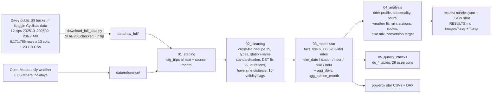

# da-learn-25 · Bike-share trips (Divvy Chicago, Oct 2025 - Sep 2026)

A data-analyst learning project on the real **Divvy bike-share trip data** from Chicago, the data behind the Kaggle *Cyclistic bike-share*
datasets of the Google Data Analytics capstone: **12 monthly files, 6,171,785 raw ride rows (13 columns, 1.23 GB of CSV)**, every trip that
started from 1 October 2025 to 30 September 2026. The project answers the capstone's business task, *how do annual members and casual riders
use the bikes differently, and how could casual riders be converted to members?*, and adds what the usual capstone skips: daily weather,
holidays, a station map, a cleaning audit and a star schema.

The cleaning problems are real ones: the same ride published in two monthly files, false starts under a minute, bikes never returned, test
and depot stations, station names with trailing `*` and spaces, a leading space in station ids, a daylight-saving clock change that produces
negative durations, a 2025 file name inside the 2026 zip, and 20.9% of rides (dockless e-bikes) with no station and coordinates rounded to
about 1 km. DuckDB runs the whole SQL pipeline locally on the **full** data in about 40 seconds. The outputs are a Power BI kit plus 18
charts and a dashboard as SVG and PNG in `results/images/`.

> **Databricks was skipped** for this project because the Databricks workspace hit its resource quota. There is no live Lakeview dashboard. The SQL
> stays Databricks/Spark-compatible (the DuckDB shims are isolated in `sql/00`), and all charts and KPIs are in [`results/`](results/RESULTS.md).


## Business questions
1. How many rides do members and casual riders take, and how long and how far do they ride?
2. When do they ride: month and season, weekday vs weekend, hour of day?
3. How strongly do temperature and rain drive demand for each rider type?
4. Which bikes do they choose (classic vs e-bike), and how much of the system is dockless?
5. Where do casual riders start, which stations do they dominate, and what are the most popular routes?
6. Which casual rides already look like member rides (the membership-conversion target)?
7. How clean are the raw files (duplicates, false starts, lost bikes, test stations, DST, station-name variants), and what had to be fixed?

## Pipeline


## Headline insights (full data, 6,006,520 valid rides)
1. **Members ride more often, casual riders ride longer.** Members took 64.87% of rides (3,896,296) and casual riders 35.13% (2,110,224), but
   casual riders used 44.66% of all ride minutes. Median ride 8.68 vs 11.13 min (mean 12.16 vs 18.13); 6.65% of casual rides last over 45 minutes
   vs 1.52% of member rides. Station-to-station distances are similar (median 1.63 vs 1.79 km), so casual riders ride slower (10.4 vs 12.1 km/h)
   and make three times as many round trips (4.92% vs 1.50%).
2. **Members commute, casual riders ride for leisure.** Weekday member rides peak at 8:00 (991 rides per day) and 17:00 (1,386); 37.82% of member
   rides start in weekday commute hours (7-9, 16-18) vs 24.12% of casual rides. 40.47% of casual rides fall on weekends or holidays (members
   25.48%); on an average weekend day casual riders take 7,502 rides vs 8,713 by members (46.3% casual vs 30.2% on ordinary weekdays).
3. **Casual demand is far more seasonal and weather-driven.** Summer vs winter rides per day: members 15,819 vs 4,182 (x3.78), casual riders 10,633
   vs 1,011 (x10.52); the casual share of rides runs from 17.86% in January 2026 to 40.85% in July 2026. Daily rides correlate with mean
   temperature at 0.869 (members) and 0.801 (casual): each +1 C adds about 425 member and 342 casual rides a day. In May-Sep, heavy-rain days
   (5 mm+) cut weekend casual rides from 14,240 to 10,202 a day (-28%) and weekday member rides from 17,107 to 14,659 (-14%).
4. **Casual riders cluster on the lakefront, not downtown in general.** Navy Pier is the top casual start (49,557 casual starts, 75.8% casual), and
   among the 333 stations with at least 5,000 starts the most casual are Shedd Aquarium (81.6%), Field Museum (81.0%) and DuSable Lake Shore Dr &
   Monroe St (78.5%). The busiest casual route is a Navy Pier round trip (9,162 rides, median 25 min); the busiest member routes are 4-minute hops
   around the University of Chicago (Ellis Ave & 60th St -> Ellis Ave & 55th St, 2,727 rides). Distance from the Loop does not separate the
   groups: 36.2% of member and 36.4% of casual rides start within 3 km of State & Madison.
5. **A concrete membership target.** 404,789 casual rides (19.18% of casual rides) already look like member rides: weekday commute hours, under 20
   minutes, station to station. Those riders suit a commuter membership; the summer-weekend lakefront riders suit a weekend / seasonal pass, with
   campaigns in April-June ahead of the July peak.
6. **E-bikes are the default.** E-bikes carried 70.39% of valid rides (74.21% of casual, 68.32% of member rides), rising from 66.69% in October 2025
   to 74.81% in September 2026; about 28-29% of e-bike rides start away from any dock (20.01% of all rides).
7. **Cleaning mattered.** 6,171,785 raw rows -> 6,171,750 distinct rides (35 rides published in both the April and May 2026 files) -> 6,006,520
   valid rides (97.32%). The 165,230 invalid rides are mostly false starts under 60 s (158,567), plus rides over 24 h, rides without an end
   location, test/depot stations, the 30 Sep 2025 spill-over, out-of-area and > 45 km/h rides. 29 rides had negative durations only because the
   clocks went back on 2 Nov 2025; they were fixed (+60 min). 28/28 assertions pass.

Full tables, all insights and the data-quality evidence are in [`results/RESULTS.md`](results/RESULTS.md).

## Charts
All charts are in `results/images/` as SVG (plain vector shapes, no embedded raster) and PNG (2x headless-Chrome render of the same SVG).
The dashboard is [`dashboard.svg`](results/images/dashboard.svg) / [`dashboard.png`](results/images/dashboard.png).

| | |
|---|---|
|  |  |
|  |  |
|  |  |
|  |  |
|  |  |
|  |  |
|  |  |
|  |  |
|  |  |

**How the images were made:** `scripts/make_charts.py` reads the DuckDB query results exported to `results/tables/*.csv` and writes each chart as a
plain-vector SVG with the small custom writer `scripts/svgcharts.py` (rect/line/polyline/polygon/circle/text only, no plotting library; the station
map is a longitude/latitude scatter, no basemap). `scripts/render_png.py` then rasterises every SVG to PNG at 2x with headless Google Chrome.

## How to run
```bash
pip install -r requirements.txt
python run_pipeline.py --source sample       # committed raw sample in data/raw/ (25,287 rides, 4.9 MB) -> results/sample/
python scripts/download_full_data.py         # 236.7 MB of zips -> 1.23 GB of CSV in data/raw_full/ (Divvy S3, SHA-256 checked)
python run_pipeline.py --source full         # full data (~40 s of SQL, ~3 GB RAM): results/, data/clean/, powerbi/data/, RESULTS.md
python scripts/render_png.py                 # results/images/*.svg -> *.png with headless Chrome
```
`scripts/make_sample.py` rebuilds the committed sample from the full files. The runner stops with an error if any assertion fails: 28/28 pass on
the full data; on the sample 25 pass and the 3 checks that need the whole year (every day has rides, 12 months with >= 100,000 rides, invalid
share) report `SKIP`. The weather file is committed; `python scripts/download_full_data.py --weather` re-fetches it from Open-Meteo.

## Method notes
- **Window and time zone.** Rides that *started* 2025-10-01 00:00 to 2026-09-30 23:59, Chicago local time (the timestamps carry no zone; the
  weekday 8:00 / 17:00 member peaks confirm local time). Each monthly file holds rides that ended in that month, so the October 2025 file has 71
  rides from 30 Sep 2025 (dropped) and rides that start on 30 Sep 2026 and end in October 2026 will only appear in the next file.
- **Deduplication.** Identical rows across files are collapsed first (35 rides at the April/May 2026 boundary), then one row per `ride_id`
  (no ride_id ever came back with different content).
- **Validity.** A ride is valid if it lasts 60 s to 24 h, has an end location, starts and ends inside the service-area box (lat 41.60-42.10,
  lng -87.95..-87.50), touches no test/depot/warehouse station and its straight-line speed is <= 45 km/h (e-bikes are capped at 32 km/h).
  Invalid rides stay in `cln_trips` with `invalid_reason`; flag counts in `dq_issues` can overlap.
- **Daylight saving.** Clocks went back at 02:00 on 2 Nov 2025: rides that started in the first 01:xx hour and ended in the repeated one show
  `ended_at < started_at`. Those 29 rides get +60 minutes (`dq_dst_fixed`); no other negative durations remain.
- **Stations.** Keyed by standardised name (trim, trailing `*` removed, repeated spaces collapsed: 7 name variants merged), because Divvy
  re-uses and renames station ids (61 stations appear with more than one id). Coordinates are the median of the precise ride coordinates at
  the station. Types: Dock (1,282), Public rack (737), Temporary dock (1), Test / depot (9); key 0 = dockless e-bike start or end.
- **Distance and speed.** Haversine between station coordinates (or ride coordinates for dockless ends). Dockless coordinates are rounded to 2
  decimals (~1 km), so those distances are flagged `distance_is_approx` and left out of the distance and speed medians; round trips are 0 km.
- **Weather.** Open-Meteo historical archive, daily values for the Loop grid cell; precipitation is the 24-hour total, so a rainy night counts
  as a wet day. The rain comparison is limited to May-Sep so temperature and daylight are comparable.
- **Conversion target.** "Commute-like" casual ride = weekday (not a holiday), start 7-9 or 16-18 h, under 20 minutes, not a round trip.

## Repo layout
```
data/raw/            deterministic sample of the 12 raw monthly files (25,287 of 6,171,785 rides); full files via scripts/download_full_data.py
data/reference/      Chicago daily weather (Open-Meteo, CC BY 4.0) and US federal holidays in the window
data/clean/          star schema from the full run (dims + complete aggregates + 1/256 ride sample) + invalid_rides_summary.csv
sql/                 00 DuckDB shims, 01 staging, 02 cleaning, 03 star model, 04 analysis, 05 quality checks
run_pipeline.py      runs sql/00-05 on DuckDB and writes all outputs (--source sample | full)
scripts/             download, sample builder, chart writer (svgcharts.py, make_charts.py), PNG renderer, RESULTS.md writer, project settings
powerbi/             star CSVs, measures.dax, model.md, dashboard_spec.md, BUILD_GUIDE.md (no .pbix: needs Windows)
results/             RESULTS.md, metrics.json, JSON.shot, tables/*.csv, images/*.svg + *.png, sample/ (same pipeline on the sample)
```

## Complete dataset
This repo only holds a deterministic sample of the raw data (the licence allows the data as source material for analyses, not re-publication as
a stand-alone dataset). The complete dataset is:

- **Kaggle page:** the Cyclistic (Divvy) capstone datasets, e.g. [Cyclistic Bike-Share Ride Data Oct 2024 - Sep 2025](https://www.kaggle.com/datasets/tanjiropanjaitan/cyclistic-bike-share-ride-data-oct-2024-sep-2025)
  (the previous 12 months, same schema) and [Google Data Analytics Capstone Cyclistic Project](https://www.kaggle.com/datasets/ahmadhier/google-data-analytics-capstone-project-dataset).
  They are copies of the monthly Divvy files used here; this project takes the newest 12 months straight from the source.
- **Source / mirror used here:** the public Divvy trip-data bucket, [divvy-tripdata.s3.amazonaws.com](https://divvy-tripdata.s3.amazonaws.com/index.html)
  (linked from [divvybikes.com/system-data](https://divvybikes.com/system-data)):
  - `https://divvy-tripdata.s3.amazonaws.com/202510-divvy-tripdata.zip`
  - `https://divvy-tripdata.s3.amazonaws.com/202511-divvy-tripdata.zip`
  - `https://divvy-tripdata.s3.amazonaws.com/202512-divvy-tripdata.zip`
  - `https://divvy-tripdata.s3.amazonaws.com/202601-divvy-tripdata.zip`
  - `https://divvy-tripdata.s3.amazonaws.com/202602-divvy-tripdata.zip`
  - `https://divvy-tripdata.s3.amazonaws.com/202603-divvy-tripdata.zip`
  - `https://divvy-tripdata.s3.amazonaws.com/202604-divvy-tripdata.zip`
  - `https://divvy-tripdata.s3.amazonaws.com/202605-divvy-tripdata.zip`
  - `https://divvy-tripdata.s3.amazonaws.com/202606-divvy-tripdata.zip`
  - `https://divvy-tripdata.s3.amazonaws.com/202607-divvy-tripdata.zip`
  - `https://divvy-tripdata.s3.amazonaws.com/202608-divvy-tripdata.zip`
  - `https://divvy-tripdata.s3.amazonaws.com/202609-divvy-tripdata.zip`
  - weather (committed in `data/reference/`): `https://archive-api.open-meteo.com/v1/archive?latitude=41.8781&longitude=-87.6298&start_date=2025-09-30&end_date=2026-09-30&daily=temperature_2m_max,temperature_2m_min,temperature_2m_mean,precipitation_sum,snowfall_sum,wind_speed_10m_max&timezone=America%2FChicago&format=csv`
- **Licence:** [Divvy Data License Agreement](https://divvybikes.com/data-license-agreement) (Lyft Bikes and Scooters, LLC, operator of Divvy for
  the City of Chicago, which owns the data): non-exclusive, royalty-free licence to access, analyse, modify and use the data; it may not be
  redistributed as a stand-alone dataset. Weather: Open-Meteo, CC BY 4.0.
- **Size:** 236,705,265 bytes zipped (12 zips), 1,233,745,894 bytes (about 1.23 GB) as CSV; 6,171,785 rows x 13 columns.
- **Files** (CSV inside each zip; zip SHA-256 in `scripts/download_full_data.py`):

  | File | Rows | CSV bytes | Zip bytes |
  |---|---|---|---|
  | `202510-divvy-tripdata.csv` | 646,039 | 128,361,274 | 24,605,753 |
  | `202511-divvy-tripdata.csv` | 356,628 | 71,109,639 | 13,591,801 |
  | `202512-divvy-tripdata.csv` | 140,534 | 28,300,500 | 5,701,852 |
  | `202601-divvy-tripdata.csv` (inside the zip as `202501-divvy-tripdata.csv`) | 137,787 | 27,856,985 | 5,907,269 |
  | `202602-divvy-tripdata.csv` | 201,450 | 41,164,802 | 8,201,530 |
  | `202603-divvy-tripdata.csv` | 317,037 | 64,047,548 | 13,165,409 |
  | `202604-divvy-tripdata.csv` | 448,252 | 89,771,695 | 17,068,744 |
  | `202605-divvy-tripdata.csv` | 653,704 | 130,660,322 | 24,934,348 |
  | `202606-divvy-tripdata.csv` | 762,550 | 152,640,622 | 28,468,364 |
  | `202607-divvy-tripdata.csv` | 869,051 | 173,089,330 | 32,910,286 |
  | `202608-divvy-tripdata.csv` | 868,191 | 172,809,981 | 32,611,393 |
  | `202609-divvy-tripdata.csv` | 770,562 | 153,933,196 | 29,538,516 |
- **Download:** `python scripts/download_full_data.py` (writes `data/raw_full/`, checks the SHA-256 of every zip and CSV).
