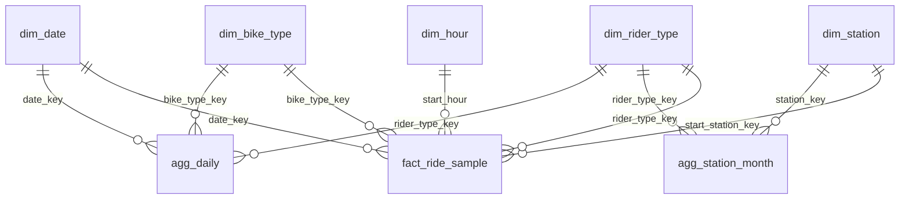

# Power BI model · da-learn-25 Bike-share trips (Divvy Chicago)

Star schema exported by `run_pipeline.py --source full` into `powerbi/data/` (same files as `data/clean/star/`). The full `fact_ride` has
6,006,520 rows (about 1 GB as CSV), so the kit ships **two aggregate facts that are complete** plus a deterministic **ride-level sample**.
Build every KPI on the aggregates; use the sample only for distributions (duration, distance) and drill-down.

| Table | Rows | Grain | Notes |
|---|---|---|---|
| agg_daily | 1,460 | date x rider type x bike type | complete: rides, ride_minutes, distance_km, round_trips, dockless_starts; sums to 6,006,520 rides |
| agg_station_month | 30,044 | start station x month (`year_month_key` = yyyymm) x rider type | complete for rides starting at a station (dockless starts excluded): rides, ride_minutes, round_trips |
| fact_ride_sample | 23,380 | one valid ride | `ride_id` ending in `00` (1/256): duration_min, distance_km, `distance_is_approx`, `is_round_trip`, `is_dockless_start/end`, `duration_band`, `dq_dst_fixed` |
| dim_date | 365 | day 2025-10-01..2026-09-30 | weekday_num (0 = Mon), day_name, is_weekend, is_holiday, holiday_name, day_type, season, Open-Meteo weather (temp mean/max/min C, precip mm, snowfall cm, wind), temp_band, weather_type |
| dim_station | 2,030 | standardised station name | key 0 = "No station (dockless e-bike)"; station_id (most frequent), station_type (Dock / Public rack / Temporary dock / Test / depot), lat, lng, dist_to_loop_km, zone |
| dim_rider_type | 2 | member / casual | |
| dim_bike_type | 2 | classic_bike / electric_bike | |
| dim_hour | 24 | start hour | daypart |

Relationships: many-to-one, single direction, from each fact to the dimensions. Two relationships from `fact_ride_sample` to `dim_station`
are possible (start and end); keep `start_station_key` active and `end_station_key` inactive (use `USERELATIONSHIP` when needed).
`agg_station_month[year_month_key]` is not related to `dim_date`; add a small `dim_month` (or use `dim_date[year_month]` with a calculated
`year_month_key = dim_date[year] * 100 + dim_date[month]`) if month slicing of station visuals is needed.

**Traps.** (1) Do not average medians across days: median ride length needs `fact_ride_sample` (or the repo's SQL); averages from
`agg_daily` are mean minutes. (2) Casual share must be a ratio of sums (`DIVIDE([Casual Rides], [Rides])`), never an average of daily shares.
(3) "Rides per day" divides by the number of calendar days in the filter context (`COUNTROWS(dim_date)`), not by days with rides.
