# RESULTS · da-learn-25 · Bike-share trips (Divvy Chicago, Oct 2025 - Sep 2026)

All numbers below come from the **full** dataset (6,171,785 raw rides in 12 monthly files) run through `sql/01`-`sql/05` on DuckDB
(1.5.6); nothing is estimated or hand-typed. Databricks was skipped because the workspace hit its resource quota, so there is no
live Lakeview dashboard; the SQL stays Databricks-compatible. Charts: `results/images/` (SVG + PNG).

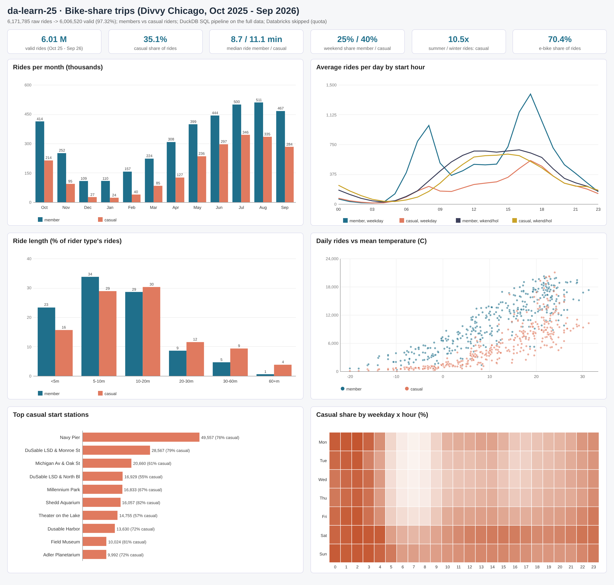

## Headline KPIs
| KPI | Value |
|---|---|
| Raw rows / distinct rides / valid rides | 6,171,785 / 6,171,750 / 6,006,520 (97.32%) |
| Window | 2025-10-01 to 2026-09-30 (365 days), Chicago local time |
| Average / busiest / quietest day | 16,456 / 2026-08-08 (39,342) / 2026-01-25 (429) |
| Member / casual rides | 3,896,296 (64.87%) / 2,110,224 (35.13%) |
| Casual share of ride minutes | 44.66% |
| Median / mean ride, member vs casual | 8.68 / 12.16 min vs 11.13 / 18.13 min |
| Rides over 45 min, member vs casual | 1.52% vs 6.65% |
| Weekend / holiday share, member vs casual | 25.48% vs 40.47% |
| Weekday commute-hour share (7-9, 16-18 h), member vs casual | 37.82% vs 24.12% |
| Round trips, member vs casual | 1.50% vs 4.92% |
| E-bike share (all / member / casual) | 70.39% / 68.32% / 74.21% |
| Dockless e-bike starts | 20.01% of valid rides |
| Stations with starts / docks / public racks | 1,961 / 1,282 / 737 |
| Summer / winter rides per day: member, casual | 15,819 / 4,182 (x3.78); 10,633 / 1,011 (x10.52) |
| Daily rides vs temperature: corr, rides per +1 C | member 0.869, +425; casual 0.801, +342 |
| Commute-like casual rides (conversion target) | 404,789 (19.18% of casual rides) |
| Assertions | 28/28 PASS |

## Insights
1. **Members ride more often, casual riders ride longer.** Of 6,006,520 valid rides, annual members took 64.87% (3,896,296) and casual riders 35.13% (2,110,224), but casual riders used 44.66% of all ride minutes. Median ride 8.68 min vs 11.13 min (mean 12.16 vs 18.13); 6.65% of casual rides last over 45 minutes vs 1.52% of member rides. Station-to-station distances are similar (median 1.63 vs 1.79 km), so casual riders are slower (10.4 vs 12.1 km/h median straight-line speed) and make 4.92% round trips vs 1.50%: they meander, members go from A to B.
2. **Members commute, casual riders ride for leisure.** On weekdays member rides peak at 8:00 (991 rides per day) and 17:00 (1,386); 37.82% of member rides start in weekday 7-9 / 16-18 h vs 24.12% of casual rides. 40.47% of casual rides fall on weekends or holidays (members 25.48%); on an average weekend day casual riders take 7,502 rides vs 8,713 by members (46.3% casual, ordinary weekdays 30.2%). The casual share runs from 16.3% (Tuesday 7:00) to 60.3% (Monday 2:00).
3. **Casual demand is far more seasonal and weather-driven.** Summer vs winter rides per day: members 15,819 vs 4,182 (x3.78), casual riders 10,633 vs 1,011 (x10.52). The casual share of rides goes from 17.86% (2026-01) to 40.85% (2026-07). Daily rides correlate with mean temperature at 0.869 (members) and 0.801 (casual); each +1 C adds about 425 member and 342 casual rides a day. Below -5 C (36 days) casual riders average 564 rides a day; at 20-25 C (81 days) 11,203. In May-Sep, heavy-rain days (5 mm+) cut weekend casual rides from 14,240 to 10,202 a day (-28%) and weekday member rides from 17,107 to 14,659 (-14%).
4. **Casual riders cluster on the lakefront.** The top casual start station is Navy Pier (49,557 casual starts, 75.8% casual), then DuSable Lake Shore Dr & Monroe St (28,567) and Michigan Ave & Oak St (20,660). Among 333 stations with at least 5,000 starts the most casual are Shedd Aquarium (81.6%), Field Museum (81.0%) and DuSable Lake Shore Dr & Monroe St (78.5%). The busiest casual route is a Navy Pier round trip (9,162 rides, median 25 min); the busiest member routes are short hops around the University of Chicago (Ellis Ave & 60th St -> Ellis Ave & 55th St, 2,727 rides, median 4 min). Distance from the Loop does not separate the groups: 36.2% of member and 36.4% of casual rides start within 3 km of State & Madison.
5. **A concrete membership target.** 404,789 casual rides (19.18% of casual rides) already look like member rides: weekday 7-9 / 16-18 h, under 20 minutes, station to station. Those riders, plus summer-weekend visitors at the lakefront stations above, are the natural audience for a commuter membership and a weekend / seasonal pass respectively; campaigns should run April-June, before the casual peak in 2026-07.
6. **E-bikes are now the default.** E-bikes carried 70.39% of valid rides (74.21% of casual, 68.32% of member rides), up from 66.69% in 2025-10 to 74.81% in 2026-09. 28.9% of member and 27.6% of casual e-bike rides start away from any dock (20.01% of all rides). Classic bikes are kept for longer casual rides (median 15.6 min vs 10.1 on e-bikes).
7. **Cleaning mattered.** 6,171,785 raw rows -> 6,171,750 distinct rides (35 rides were published in both the April and May 2026 files) -> 6,006,520 valid rides (97.32%). The 165,230 invalid rides are mostly false starts under 60 s (158,567), plus rides over 24 h, rides with no end location, test/depot stations, the 30 Sep 2025 spill-over, out-of-area and > 45 km/h rides. 29 rides had negative durations only because clocks went back on 2 Nov 2025 and were fixed. 28/28 assertions pass.

## Members vs casual riders
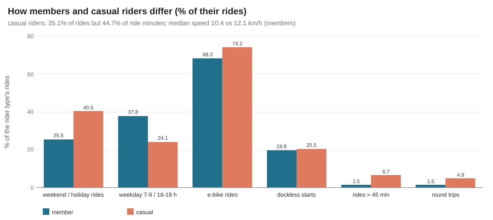
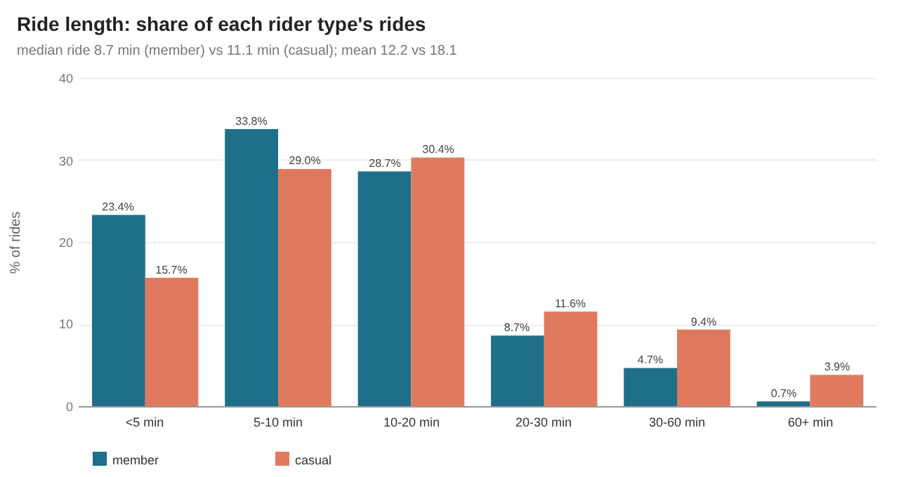
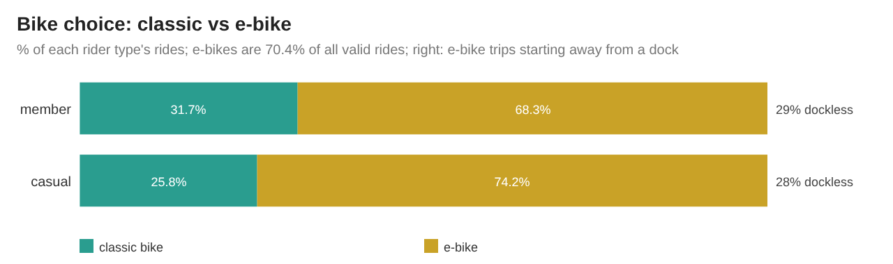

| Rider | Rides | % rides | Ride hours | % minutes | Median min | Mean min | P90 min | Median km | Median km/h | E-bike % | Round trip % | Weekend % | Dockless start % | > 45 min % |
|---|---|---|---|---|---|---|---|---|---|---|---|---|---|---|
| member | 3,896,296 | 64.87 | 789,959 | 55.34 | 8.68 | 12.16 | 23.38 | 1.63 | 12.09 | 68.32 | 1.5 | 25.48 | 19.77 | 1.52 |
| casual | 2,110,224 | 35.13 | 637,566 | 44.66 | 11.13 | 18.13 | 35.65 | 1.79 | 10.39 | 74.21 | 4.92 | 40.47 | 20.46 | 6.65 |

| Rider | Duration band | Rides | % of rider rides |
|---|---|---|---|
| casual | 01 <5 min | 331,717 | 15.72 |
| casual | 02 5-10 min | 611,461 | 28.98 |
| casual | 03 10-20 min | 641,169 | 30.38 |
| casual | 04 20-30 min | 244,988 | 11.61 |
| casual | 05 30-60 min | 198,874 | 9.42 |
| casual | 06 60+ min | 82,015 | 3.89 |
| member | 01 <5 min | 911,441 | 23.39 |
| member | 02 5-10 min | 1,318,693 | 33.84 |
| member | 03 10-20 min | 1,117,795 | 28.69 |
| member | 04 20-30 min | 338,359 | 8.68 |
| member | 05 30-60 min | 184,477 | 4.73 |
| member | 06 60+ min | 25,531 | 0.66 |

| Rider | Bike | Rides | % of rider rides | Median min | Dockless start % | Dockless end % |
|---|---|---|---|---|---|---|
| casual | classic_bike | 544,249 | 25.79 | 15.55 | 0 | 0 |
| casual | electric_bike | 1,565,975 | 74.21 | 10.08 | 27.58 | 31.21 |
| member | classic_bike | 1,234,493 | 31.68 | 9.15 | 0 | 0 |
| member | electric_bike | 2,661,803 | 68.32 | 8.5 | 28.94 | 28.43 |

## Seasonality and weather
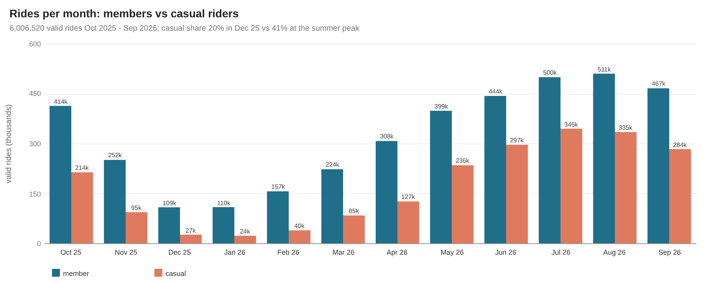
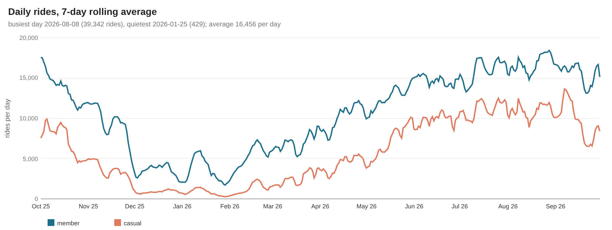
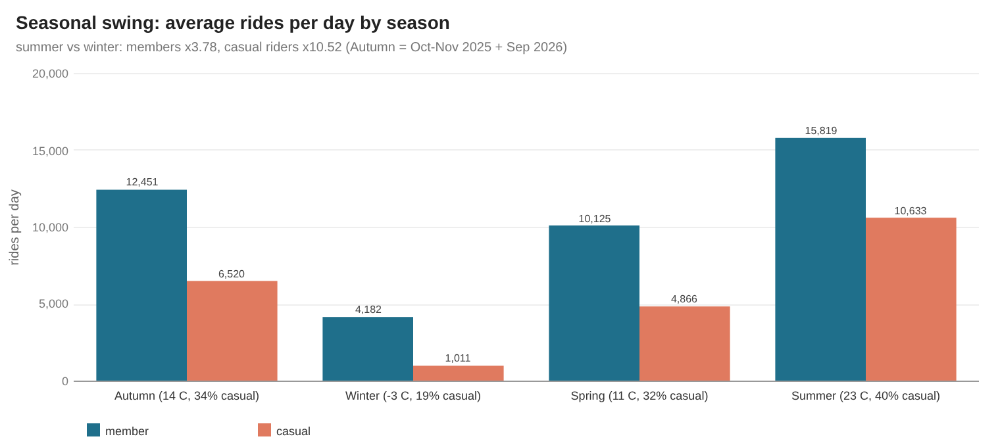
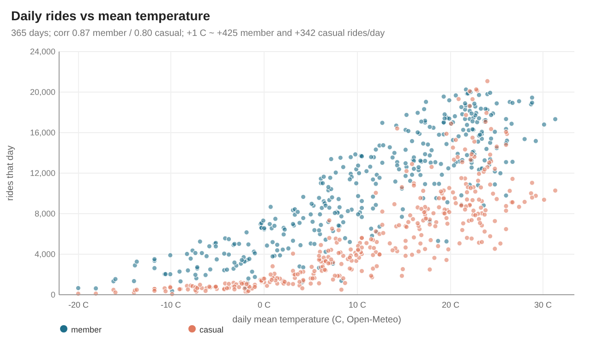
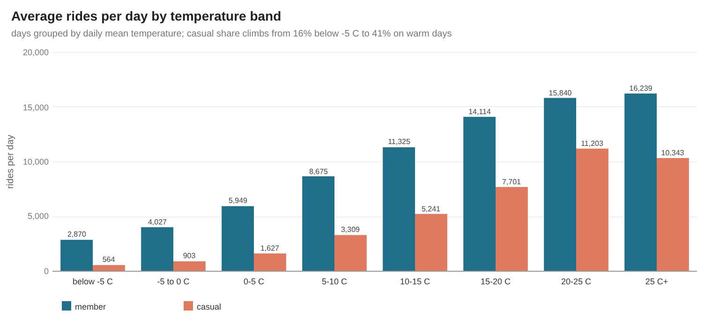
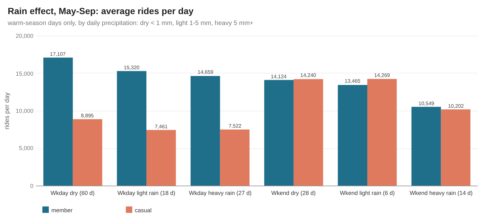

| Month | Member rides | Casual rides | Rides | Casual % | Member median min | Casual median min | E-bike % | Ride-weighted temp C |
|---|---|---|---|---|---|---|---|---|
| 2025-10 | 414,120 | 214,396 | 628,516 | 34.11 | 8.57 | 10.72 | 66.69 | 14.9 |
| 2025-11 | 251,881 | 94,701 | 346,582 | 27.32 | 7.92 | 8.95 | 66.81 | 7.6 |
| 2025-12 | 109,337 | 27,088 | 136,425 | 19.86 | 7.48 | 7.67 | 67.2 | -2.1 |
| 2026-01 | 109,817 | 23,876 | 133,693 | 17.86 | 7.17 | 7.1 | 67.27 | -2.1 |
| 2026-02 | 157,206 | 40,068 | 197,274 | 20.31 | 7.43 | 8.18 | 66.16 | 1.9 |
| 2026-03 | 223,623 | 84,802 | 308,425 | 27.5 | 7.87 | 9.85 | 68.94 | 7.3 |
| 2026-04 | 308,417 | 127,008 | 435,425 | 29.17 | 8.2 | 10.02 | 69.46 | 12.6 |
| 2026-05 | 399,456 | 235,853 | 635,309 | 37.12 | 8.87 | 11.8 | 69.25 | 16.2 |
| 2026-06 | 444,101 | 297,216 | 741,317 | 40.09 | 9.47 | 12.32 | 69.37 | 21 |
| 2026-07 | 500,356 | 345,533 | 845,889 | 40.85 | 9.35 | 11.95 | 72.12 | 24.3 |
| 2026-08 | 510,934 | 335,496 | 846,430 | 39.64 | 9.33 | 11.75 | 73.67 | 22.7 |
| 2026-09 | 467,048 | 284,187 | 751,235 | 37.83 | 8.9 | 11.05 | 74.81 | 20.9 |

| Season | Days | Avg temp C | Member rides/day | Casual rides/day | Casual % |
|---|---|---|---|---|---|
| Winter | 90 | -2.9 | 4,182 | 1,011 | 19.48 |
| Spring | 92 | 10.9 | 10,125 | 4,866 | 32.46 |
| Autumn | 91 | 13.5 | 12,451 | 6,520 | 34.37 |
| Summer | 92 | 22.7 | 15,819 | 10,633 | 40.2 |

| Temperature band | Days | Member rides/day | Casual rides/day | Casual % |
|---|---|---|---|---|
| 01 below -5 C | 36 | 2,870 | 564 | 16.42 |
| 02 -5 to 0 C | 33 | 4,027 | 903 | 18.31 |
| 03 0-5 C | 33 | 5,949 | 1,627 | 21.48 |
| 04 5-10 C | 58 | 8,675 | 3,309 | 27.61 |
| 05 10-15 C | 42 | 11,325 | 5,241 | 31.64 |
| 06 15-20 C | 61 | 14,114 | 7,701 | 35.3 |
| 07 20-25 C | 81 | 15,840 | 11,203 | 41.43 |
| 08 25 C and above | 21 | 16,239 | 10,343 | 38.91 |

| Day type (May-Sep) | Rain | Days | Avg temp C | Member rides/day | Casual rides/day |
|---|---|---|---|---|---|
| Weekday | 1 dry (< 1 mm) | 60 | 20.4 | 17,107 | 8,895 |
| Weekday | 2 light rain (1-5 mm) | 18 | 18.7 | 15,320 | 7,461 |
| Weekday | 3 heavy rain (5 mm+) | 27 | 23.3 | 14,659 | 7,522 |
| Weekend / holiday | 1 dry (< 1 mm) | 28 | 19.7 | 14,124 | 14,240 |
| Weekend / holiday | 2 light rain (1-5 mm) | 6 | 21.7 | 13,465 | 14,269 |
| Weekend / holiday | 3 heavy rain (5 mm+) | 14 | 21.9 | 10,549 | 10,202 |

| Rider | Days | corr(temp, rides) | Rides per +1 C | Rides at 0 C (fit) |
|---|---|---|---|---|
| casual | 365 | 0.8 | 342 | 1,978.3 |
| member | 365 | 0.87 | 425.2 | 5,946 |

## Weekly and daily rhythm
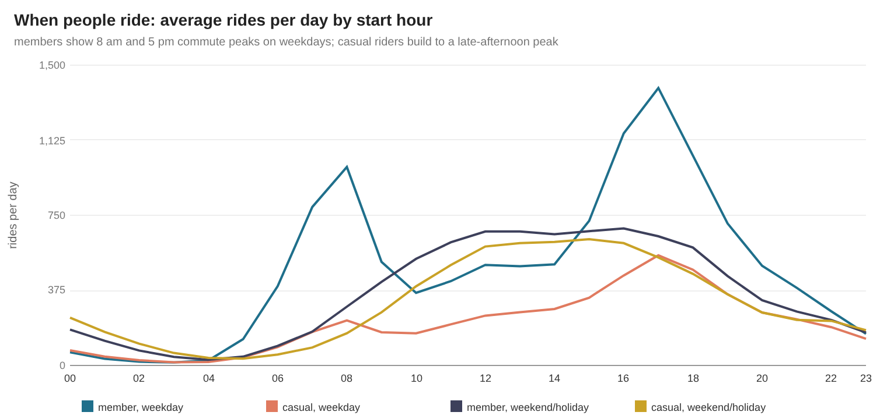
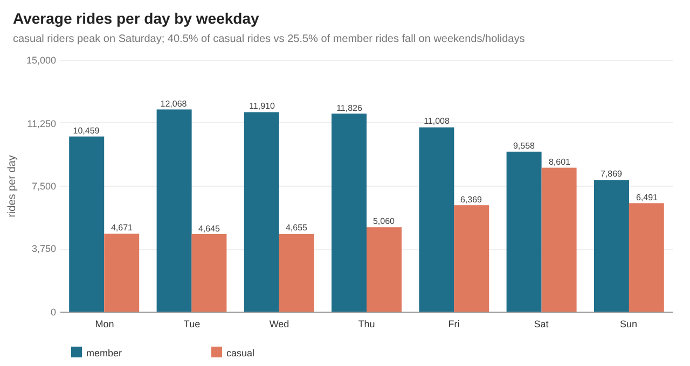
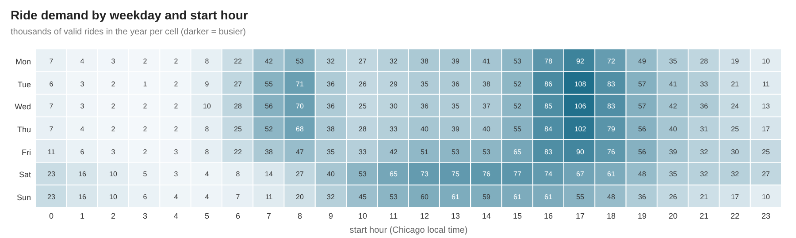
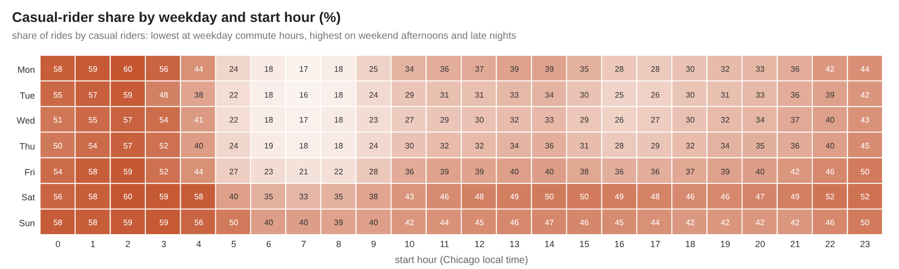

| Day | Rider | Rides | Days | Rides/day | Median min |
|---|---|---|---|---|---|
| Mon | casual | 242,884 | 52 | 4,671 | 10.8 |
| Mon | member | 543,878 | 52 | 10,459 | 8.4 |
| Tue | casual | 241,545 | 52 | 4,645 | 9.87 |
| Tue | member | 627,558 | 52 | 12,068 | 8.5 |
| Wed | casual | 246,706 | 53 | 4,655 | 9.67 |
| Wed | member | 631,248 | 53 | 11,910 | 8.48 |
| Thu | casual | 263,104 | 52 | 5,060 | 9.92 |
| Thu | member | 614,966 | 52 | 11,826 | 8.5 |
| Fri | casual | 331,185 | 52 | 6,369 | 10.98 |
| Fri | member | 572,425 | 52 | 11,008 | 8.57 |
| Sat | casual | 447,276 | 52 | 8,601 | 13.02 |
| Sat | member | 497,013 | 52 | 9,558 | 9.55 |
| Sun | casual | 337,524 | 52 | 6,491 | 12.78 |
| Sun | member | 409,208 | 52 | 7,869 | 9.23 |

| Day kind | Days | Member rides/day | Casual rides/day | Casual % |
|---|---|---|---|---|
| Federal holiday | 12 | 7,958 | 6,772 | 45.98 |
| Ordinary weekday | 250 | 11,614 | 5,025 | 30.2 |
| Weekend | 103 | 8,713 | 7,502 | 46.27 |

## Stations and routes
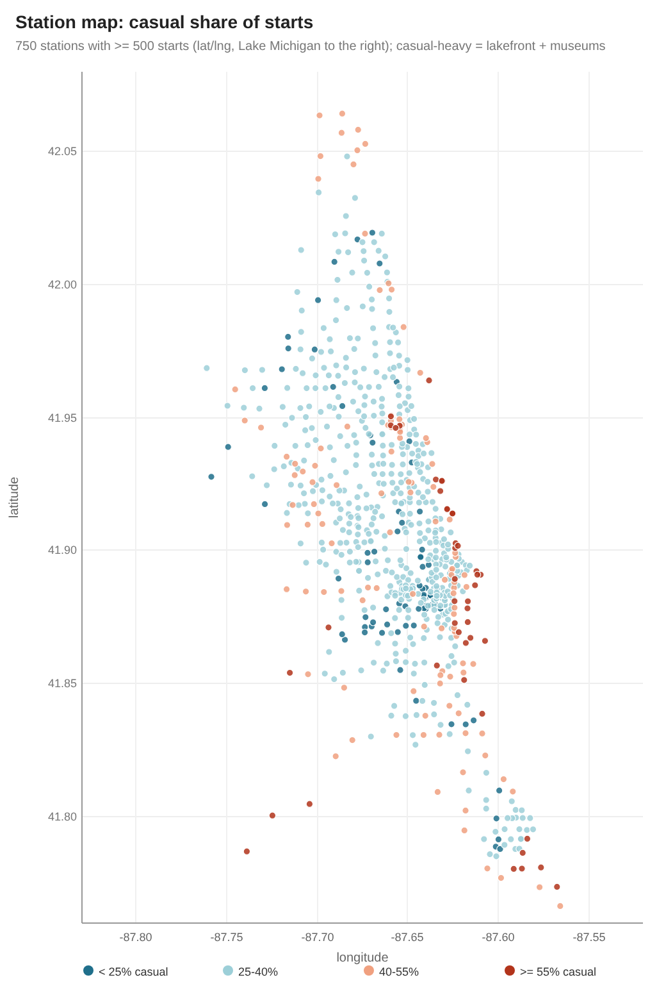
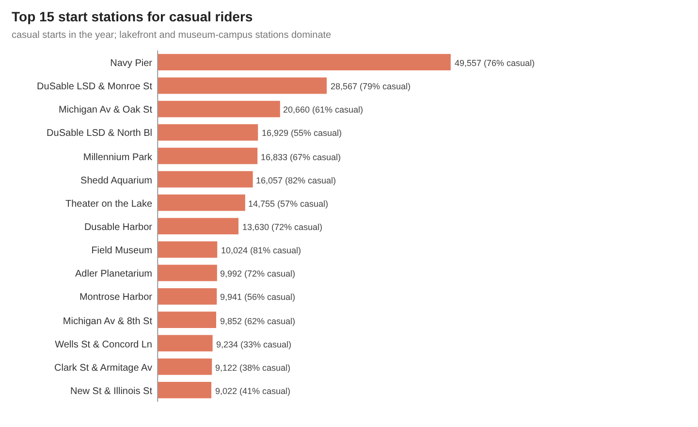
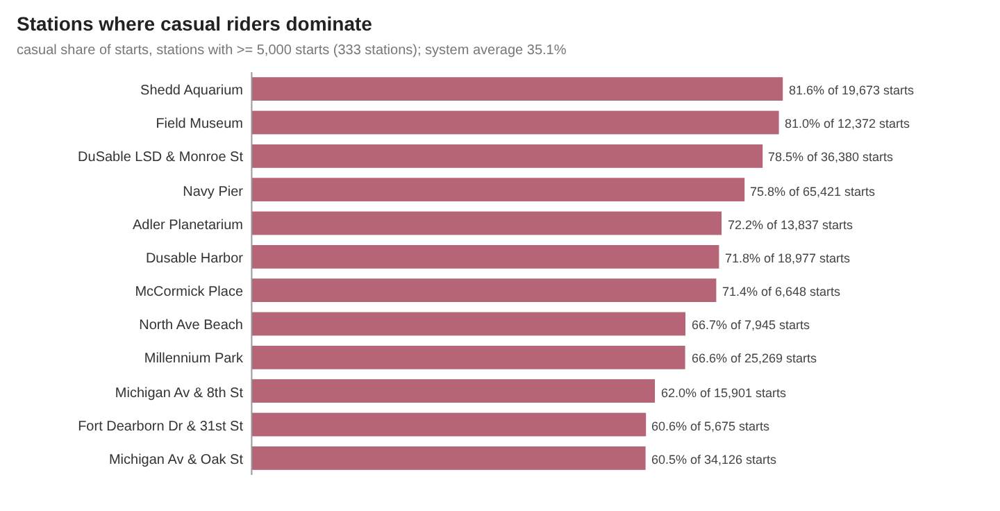
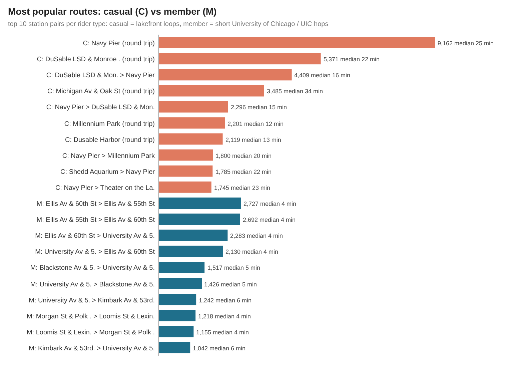

| # | Station (casual top 15) | Zone | Casual starts | All starts | Casual % | Round trip % |
|---|---|---|---|---|---|---|
| 1 | Navy Pier | 1 Loop + near downtown (< 3 km) | 49,557 | 65,421 | 75.75 | 15.36 |
| 2 | DuSable Lake Shore Dr & Monroe St | 1 Loop + near downtown (< 3 km) | 28,567 | 36,380 | 78.52 | 15.7 |
| 3 | Michigan Ave & Oak St | 1 Loop + near downtown (< 3 km) | 20,660 | 34,126 | 60.54 | 11.33 |
| 4 | DuSable Lake Shore Dr & North Blvd | 2 Inner neighbourhoods (3-8 km) | 16,929 | 30,977 | 54.65 | 5.55 |
| 5 | Millennium Park | 1 Loop + near downtown (< 3 km) | 16,833 | 25,269 | 66.62 | 9.22 |
| 6 | Shedd Aquarium | 1 Loop + near downtown (< 3 km) | 16,057 | 19,673 | 81.62 | 8.49 |
| 7 | Theater on the Lake | 2 Inner neighbourhoods (3-8 km) | 14,755 | 26,022 | 56.7 | 6.36 |
| 8 | Dusable Harbor | 1 Loop + near downtown (< 3 km) | 13,630 | 18,977 | 71.82 | 12.45 |
| 9 | Field Museum | 1 Loop + near downtown (< 3 km) | 10,024 | 12,372 | 81.02 | 7.15 |
| 10 | Adler Planetarium | 1 Loop + near downtown (< 3 km) | 9,992 | 13,837 | 72.21 | 11.93 |
| 11 | Montrose Harbor | 3 Outer neighbourhoods (8-15 km) | 9,941 | 17,759 | 55.98 | 11.04 |
| 12 | Michigan Ave & 8th St | 1 Loop + near downtown (< 3 km) | 9,852 | 15,901 | 61.96 | 8.89 |
| 13 | Wells St & Concord Ln | 2 Inner neighbourhoods (3-8 km) | 9,234 | 28,283 | 32.65 | 1.39 |
| 14 | Clark St & Armitage Ave | 2 Inner neighbourhoods (3-8 km) | 9,122 | 24,079 | 37.88 | 2.78 |
| 15 | New St & Illinois St | 1 Loop + near downtown (< 3 km) | 9,022 | 22,152 | 40.73 | 4.7 |

| # | Station (member top 15) | Zone | Member starts | All starts | Casual % | Round trip % |
|---|---|---|---|---|---|---|
| 1 | Canal St & Madison St | 1 Loop + near downtown (< 3 km) | 22,697 | 29,050 | 21.87 | 0.93 |
| 2 | State St & Chicago Ave | 1 Loop + near downtown (< 3 km) | 22,159 | 30,029 | 26.21 | 1.89 |
| 3 | Clinton St & Jackson Blvd | 1 Loop + near downtown (< 3 km) | 19,874 | 25,018 | 20.56 | 0.76 |
| 4 | Wells St & Elm St | 1 Loop + near downtown (< 3 km) | 19,179 | 27,242 | 29.6 | 1.44 |
| 5 | Wells St & Concord Ln | 2 Inner neighbourhoods (3-8 km) | 19,049 | 28,283 | 32.65 | 1.39 |
| 6 | Clinton St & Madison St | 1 Loop + near downtown (< 3 km) | 18,529 | 24,957 | 25.76 | 1.24 |
| 7 | Kingsbury St & Kinzie St 2 | 1 Loop + near downtown (< 3 km) | 18,136 | 23,169 | 21.72 | 0.78 |
| 8 | Wells St & Hubbard St | 1 Loop + near downtown (< 3 km) | 17,772 | 25,700 | 30.85 | 1.54 |
| 9 | Wells St & Huron St | 1 Loop + near downtown (< 3 km) | 17,320 | 24,607 | 29.61 | 1.52 |
| 10 | Clinton St & Washington Blvd 2 | 1 Loop + near downtown (< 3 km) | 17,307 | 21,386 | 19.07 | 0.84 |
| 11 | University Ave & 57th St | 3 Outer neighbourhoods (8-15 km) | 16,144 | 21,232 | 23.96 | 2.77 |
| 12 | Navy Pier | 1 Loop + near downtown (< 3 km) | 15,864 | 65,421 | 75.75 | 15.36 |
| 13 | Desplaines St & Kinzie St | 1 Loop + near downtown (< 3 km) | 15,689 | 21,920 | 28.43 | 1.36 |
| 14 | Clark St & Elm St | 1 Loop + near downtown (< 3 km) | 15,676 | 22,735 | 31.05 | 1.72 |
| 15 | Kingsbury St & Erie St | 1 Loop + near downtown (< 3 km) | 15,491 | 20,069 | 22.81 | 1.74 |

| # | Station (>= 5,000 starts) | Zone | Starts | Casual starts | Casual % | Round trip % | Casual rides on weekdays % |
|---|---|---|---|---|---|---|---|
| 1 | Shedd Aquarium | 1 Loop + near downtown (< 3 km) | 19,673 | 16,057 | 81.62 | 8.49 | 53.85 |
| 2 | Field Museum | 1 Loop + near downtown (< 3 km) | 12,372 | 10,024 | 81.02 | 7.15 | 55.34 |
| 3 | DuSable Lake Shore Dr & Monroe St | 1 Loop + near downtown (< 3 km) | 36,380 | 28,567 | 78.52 | 15.7 | 49.39 |
| 4 | Navy Pier | 1 Loop + near downtown (< 3 km) | 65,421 | 49,557 | 75.75 | 15.36 | 50.66 |
| 5 | Adler Planetarium | 1 Loop + near downtown (< 3 km) | 13,837 | 9,992 | 72.21 | 11.93 | 54.16 |
| 6 | Dusable Harbor | 1 Loop + near downtown (< 3 km) | 18,977 | 13,630 | 71.82 | 12.45 | 52.8 |
| 7 | McCormick Place | 2 Inner neighbourhoods (3-8 km) | 6,648 | 4,747 | 71.4 | 8.18 | 58.56 |
| 8 | North Ave Beach | 2 Inner neighbourhoods (3-8 km) | 7,945 | 5,296 | 66.66 | 6.09 | 55.63 |
| 9 | Millennium Park | 1 Loop + near downtown (< 3 km) | 25,269 | 16,833 | 66.62 | 9.22 | 52.5 |
| 10 | Michigan Ave & 8th St | 1 Loop + near downtown (< 3 km) | 15,901 | 9,852 | 61.96 | 8.89 | 54.52 |
| 11 | Fort Dearborn Dr & 31st St | 2 Inner neighbourhoods (3-8 km) | 5,675 | 3,439 | 60.6 | 14.52 | 44.84 |
| 12 | Michigan Ave & Oak St | 1 Loop + near downtown (< 3 km) | 34,126 | 20,660 | 60.54 | 11.33 | 51.65 |

| Rider | # | From | To | Rides | Median min |
|---|---|---|---|---|---|
| casual | 1 | Navy Pier | Navy Pier | 9,162 | 24.9 |
| casual | 2 | DuSable Lake Shore Dr & Monroe St | DuSable Lake Shore Dr & Monroe St | 5,371 | 22.3 |
| casual | 3 | DuSable Lake Shore Dr & Monroe St | Navy Pier | 4,409 | 15.9 |
| casual | 4 | Michigan Ave & Oak St | Michigan Ave & Oak St | 3,485 | 34.2 |
| casual | 5 | Navy Pier | DuSable Lake Shore Dr & Monroe St | 2,296 | 14.6 |
| casual | 6 | Millennium Park | Millennium Park | 2,201 | 11.5 |
| casual | 7 | Dusable Harbor | Dusable Harbor | 2,119 | 12.7 |
| casual | 8 | Navy Pier | Millennium Park | 1,800 | 20.3 |
| casual | 9 | Shedd Aquarium | Navy Pier | 1,785 | 22.4 |
| casual | 10 | Navy Pier | Theater on the Lake | 1,745 | 22.7 |
| member | 1 | Ellis Ave & 60th St | Ellis Ave & 55th St | 2,727 | 4.2 |
| member | 2 | Ellis Ave & 55th St | Ellis Ave & 60th St | 2,692 | 4.4 |
| member | 3 | Ellis Ave & 60th St | University Ave & 57th St | 2,283 | 3.5 |
| member | 4 | University Ave & 57th St | Ellis Ave & 60th St | 2,130 | 3.6 |
| member | 5 | Blackstone Ave & 59th St | University Ave & 57th St | 1,517 | 4.6 |
| member | 6 | University Ave & 57th St | Blackstone Ave & 59th St | 1,426 | 4.7 |
| member | 7 | University Ave & 57th St | Kimbark Ave & 53rd St | 1,242 | 5.6 |
| member | 8 | Morgan St & Polk St | Loomis St & Lexington St | 1,218 | 4 |
| member | 9 | Loomis St & Lexington St | Morgan St & Polk St | 1,155 | 3.9 |
| member | 10 | Kimbark Ave & 53rd St | University Ave & 57th St | 1,042 | 5.6 |

| Rider | Start zone (distance from State & Madison) | Rides | % of rider rides |
|---|---|---|---|
| casual | 0 Dockless (no station) | 431,847 | 20.46 |
| casual | 1 Loop + near downtown (< 3 km) | 768,189 | 36.4 |
| casual | 2 Inner neighbourhoods (3-8 km) | 599,902 | 28.43 |
| casual | 3 Outer neighbourhoods (8-15 km) | 277,979 | 13.17 |
| casual | 4 Edge + suburbs (15 km+) | 32,307 | 1.53 |
| member | 0 Dockless (no station) | 770,282 | 19.77 |
| member | 1 Loop + near downtown (< 3 km) | 1,411,019 | 36.21 |
| member | 2 Inner neighbourhoods (3-8 km) | 1,109,156 | 28.47 |
| member | 3 Outer neighbourhoods (8-15 km) | 566,303 | 14.53 |
| member | 4 Edge + suburbs (15 km+) | 39,536 | 1.01 |

## Conversion target
| Casual rides | Weekday commute-hour rides | Commute-like (< 20 min, A to B) | % of casual | Rides > 45 min | % > 45 min |
|---|---|---|---|---|---|
| 2,110,224 | 508,937 | 404,789 | 19.18 | 140,427 | 6.65 |

## Data quality
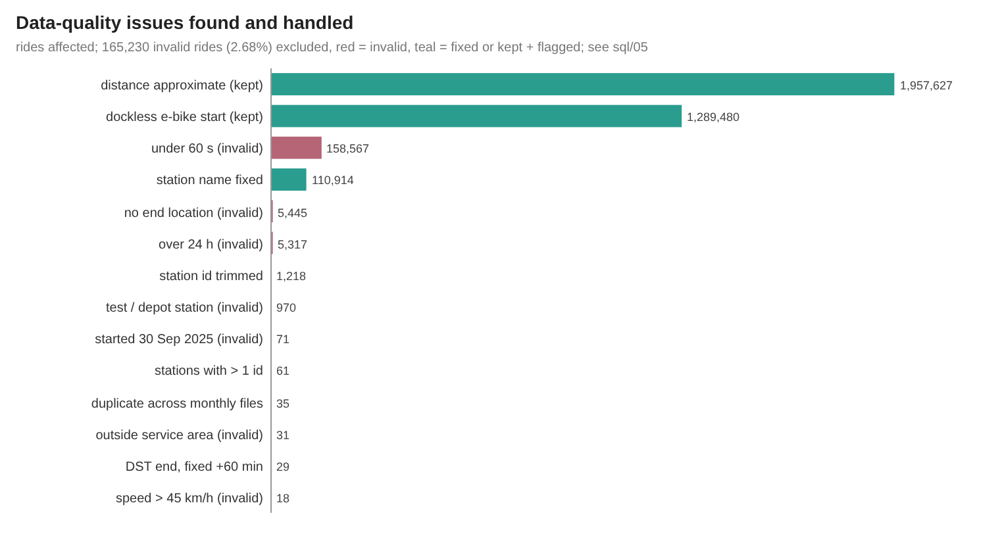

**Row counts**

| entity | raw_rows | distinct_rows | clean_rows | grain |
|---|---|---|---|---|
| agg_daily |  |  | 1,460 | date x rider type x bike type |
| agg_station_month |  |  | 30,044 | start station x month x rider type |
| dim_date |  |  | 365 | day (with weather + holiday) |
| dim_hour / dim_rider_type / dim_bike_type |  |  | 28 | 24 + 2 + 2 |
| dim_station (incl. key 0 = dockless) |  |  | 2,030 | standardised station name |
| fact_ride |  |  | 6,006,520 | valid ride |
| invalid rides (flagged, kept in cln_trips, not in fact_ride) |  |  | 165,230 | ride |
| raw trip rows (12 monthly files) | 6,171,785 | 6,171,750 | 6,006,520 | ride (clean = valid rides in fact_ride) |
| rides after dedupe (one row per ride_id) |  |  | 6,171,750 | ride |

**Issues found and how they were handled** (flags can overlap; `invalid_reason` in `cln_trips` keeps the first one)

| check_name | affected_rows |
|---|---|
| RI: valid rides lost in dimension joins | 0 |
| distances approximate (2-decimal dockless coordinates), kept + flagged | 1,957,627 |
| dockless e-bike starts (no station), kept | 1,289,480 |
| duplicate rows: same ride published in two monthly files (Apr/May 2026 boundary), dropped | 35 |
| implausible straight-line speed > 45 km/h, invalid | 18 |
| negative durations in the repeated 1 AM hour of 2 Nov 2025 (DST end), fixed +60 min | 29 |
| negative durations left after the DST fix, invalid | 0 |
| raw station-name variants merged by standardisation | 7 |
| ride_id repeated with different content (first file kept) | 0 |
| rides at test / depot / warehouse stations, invalid | 970 |
| rides outside the service-area box, invalid | 31 |
| rides over 24 h (lost / not returned), invalid | 5,317 |
| rides started before 1 Oct 2025 (spill-over in the Oct file), invalid | 71 |
| rides under 60 s (false starts / re-docks), invalid | 158,567 |
| rides with no end location, invalid | 5,445 |
| station ids with a leading space, trimmed | 1,218 |
| station names fixed (trailing space, trailing *, double space) | 110,914 |
| stations seen with more than one station id | 61 |
| zip quirk: 202601 zip contains a file named 202501-divvy-tripdata.csv (renamed on download) | 1 |

**Null / format rates (raw)**

| entity | column_name | null_pct | treatment |
|---|---|---|---|
| raw rides | end_lat / end_lng | 0.09 | no end location = bike not returned / lost: invalid |
| raw rides | end_station_name | 21.96 | dockless e-bike ends: kept, end_station_key = 0 |
| raw rides | ride_id / rideable_type / started_at / ended_at / member_casual | 0 | required: never empty |
| raw rides | start_lat (2-decimal, rounded) | 20.89 | dockless coordinates are rounded to ~1 km: distance flagged approximate |
| raw rides | start_station_id | 20.89 | id only used as an attribute; stations are keyed by clean name |
| raw rides | start_station_name | 20.89 | e-bikes can start away from a dock: kept, start_station_key = 0 (dockless) |

**Assertions (28/28 PASS)**

| check_name | failed_rows | status |
|---|---|---|
| DST fix only touches 2 Nov 2025 01:xx rides and leaves no negative valid duration | 0 | PASS |
| a_hourly rides sum back to fact_ride | 0 | PASS |
| a_monthly totals = fact_ride and member + casual = rides | 0 | PASS |
| agg_daily sums back to fact_ride (rides and minutes) | 0 | PASS |
| agg_station_month sums back to station-start rides | 0 | PASS |
| all 12 months present with >= 100,000 valid rides [full data only] | 0 | PASS |
| all timestamps parsed | 0 | PASS |
| classic bikes always start at a station | 0 | PASS |
| dim_date = 365 consecutive days with weather | 0 | PASS |
| distance >= 0 and round trips have 0 km | 0 | PASS |
| distinct rows = raw rows - exact cross-file duplicates | 0 | PASS |
| every day of the window has rides [full data only] | 0 | PASS |
| every invalid ride has exactly one reported reason | 0 | PASS |
| every station has coordinates inside the service area | 0 | PASS |
| fact keys exist in every dimension (RI) | 0 | PASS |
| fact_ride = valid rides in cln_trips | 0 | PASS |
| invalid rides below 5% of all rides [full data only] | 0 | PASS |
| member + casual ride shares = 100% | 0 | PASS |
| no ride_id with conflicting content | 0 | PASS |
| one row per ride_id in cln_trips | 0 | PASS |
| ride_id = 16 upper-case hex characters | 0 | PASS |
| rideable_type in (classic_bike, electric_bike) and member_casual in (member, casual) | 0 | PASS |
| station names standardised (trimmed, no trailing *, no double spaces) | 0 | PASS |
| station_key and station_name unique in dim_station | 0 | PASS |
| valid + invalid = all distinct rides | 0 | PASS |
| valid rides inside the service-area box | 0 | PASS |
| valid rides start inside 2025-10-01 .. 2026-09-30 | 0 | PASS |
| valid rides: 60 s <= duration <= 24 h | 0 | PASS |

## How the images were made
`scripts/make_charts.py` reads the DuckDB query results exported to `results/tables/*.csv` and writes every chart as a plain-vector SVG with the
small custom writer `scripts/svgcharts.py` (rect, line, polyline, polygon, circle and text only; no plotting library, no embedded raster).
`scripts/render_png.py` then rasterises each SVG to a PNG at 2x with headless Google Chrome. Both versions are committed in `results/images/`.
The station map is a plain longitude/latitude scatter of station coordinates (no basemap tiles).

## Files
`metrics.json` (KPIs, data-quality evidence, engine, SQL timings), `JSON.shot` (headline snapshot + run config), `tables/` (every `a_*` and
`dq_*` table as CSV), `images/` (SVG + PNG), `sample/` (the same pipeline on the committed raw sample).
